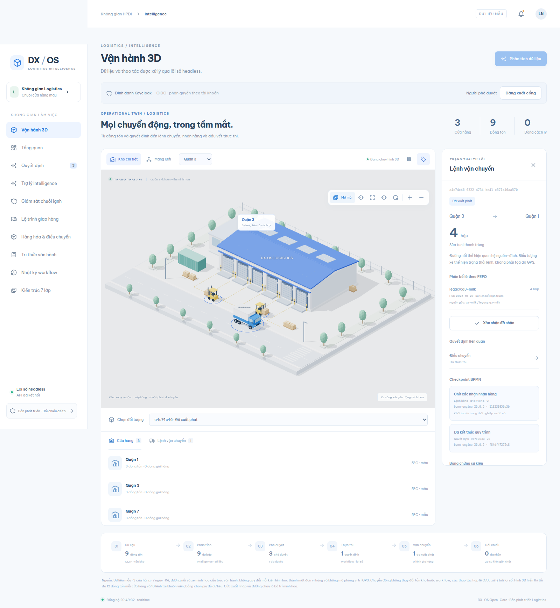

# LogiTwin — điều hành logistics hàng tươi có kho 3D



LogiTwin là nền tảng điều hành chuỗi cung ứng **hàng tươi sống** cho chuỗi cửa hàng: dự báo nhu cầu, đề xuất điều chuyển hàng giữa các kho, giám sát **chuỗi lạnh**, và hiển thị mọi lệnh vận chuyển trên **mô hình kho 3D (digital twin)**. AI chỉ đề xuất và giải trình; mọi thao tác thật đều qua người duyệt và quy trình BPMN.

Repo gộp hai dự án:

| Thư mục | Là gì |
|---|---|
| `/` (gốc) | **Ứng dụng chính**: lõi headless + cổng điều hành web + nghiệp vụ logistics, có kho 3D dùng dữ liệu thật từ API |
| `waretrack/` | **WareTrack** — mô phỏng kho vận 3D độc lập (dữ liệu tự sinh trong bộ nhớ), nguồn gốc phần 3D của ứng dụng chính |

## Chức năng

**Nghiệp vụ logistics**
- **Dự báo nhu cầu 7 ngày** theo cửa hàng, mặt hàng.
- **Đề xuất tự động**: phân bổ, điều chuyển giữa kho, giảm giá hàng sắp hết hạn.
- **Quản lý lô theo FEFO** (hết hạn trước xuất trước), tách tồn vật lý và tồn đang vận chuyển, lưu nguồn gốc lô.
- **Chuỗi lạnh 2–8 °C**: nhiệt độ vượt ngưỡng thì kho tự bị cách ly, khóa mọi lệnh xuất/nhập cho tới khi người duyệt xác nhận kiểm định.

**Duyệt và quy trình**
- Mỗi đề xuất có **5 mục giải trình**: Đề xuất · Lý do · Độ tin cậy · Giả định · Việc cần duyệt.
- **Quy trình BPMN 2.0**: Phê duyệt → Xuất kho → Xác nhận nhận hàng. Thay đổi dữ liệu và trạng thái quy trình ghi trong cùng một giao dịch.

**Kho 3D (digital twin)**
- **Kho chi tiết**: kho, mái, cửa, kệ hàng theo dữ liệu API, xe tải, xe nâng.
- **Mạng lưới**: các cửa hàng và tuyến điều chuyển; xe `in_transit` chạy trên tuyến, `received` đứng nhận hàng.
- Tạm dừng / chạy, ẩn nhãn, toàn màn hình, tôn trọng "giảm chuyển động", có bảng dự phòng khi máy không hỗ trợ WebGL, dùng được trên mobile.

**Trợ lý AI (RAG chạy tại chỗ)**
- Hỏi đáp trên tài liệu SOP nội bộ, trích đúng đoạn nguồn kèm phiên bản.
- Chạy bằng Ollama (`bge-m3` + `gemma2:2b`). AI **không tự thực thi** nghiệp vụ.

**Bảo mật**
- Đăng nhập Keycloak (OIDC + PKCE), phân quyền theo vai trò, tách dữ liệu theo tenant.
- Gateway riêng có giới hạn tần suất. Cập nhật thời gian thực qua SSE.

## Kiến trúc (theo khung DX-OS)

| Tầng | Trong LogiTwin |
|---|---|
| **1. Lõi headless** | `src/core/`: API, SQLite WAL, BPMN (`bpmn-engine`), danh tính OIDC, RAG, SSE — không có giao diện |
| **2. Cổng điều hành [I]** | `src/portal/`: React 19, kho 3D (Three.js / React Three Fiber) |
| **3. Nghiệp vụ** | `src/modules/logistics/`: dự báo, điều chuyển, chuỗi lạnh |

## Chạy ứng dụng chính

Cần Node ≥ 24.14, Docker (Keycloak), Ollama (tùy chọn, cho trợ lý AI).

```bash
npm ci
node config/identity-init.mjs              # sinh realm OIDC + tài khoản demo (var/identity.json)
docker compose -f config/compose.yaml up -d  # Keycloak
npm run dev                                # Gateway 5193 · Core 5191 · Portal 5190
```

Mở http://127.0.0.1:5190. Mật khẩu demo nằm trong `var/identity.json` (không commit).

| Tài khoản | Vai trò |
|---|---|
| `planner` | Lập kế hoạch: phân tích dữ liệu, thêm SOP, nhập nhiệt độ |
| `approver` | Phê duyệt: duyệt đề xuất, xuất giao, xác nhận nhận hàng, xác nhận kiểm định |
| `viewer` | Chỉ xem |

**Kịch bản demo:** `planner` bấm *Phân tích dữ liệu* → mở đề xuất xem 5 mục giải trình → `approver` *Duyệt* và *Thực thi* → tab *Vận hành 3D*: xe chạy (`in_transit`) → *Xác nhận đã nhận*, tồn kho đích tăng theo FEFO → nhập 12 °C tại một trạm để thấy kho bị cách ly → hỏi trợ lý AI về quy trình sự cố chuỗi lạnh.

## Chạy WareTrack độc lập

```bash
cd waretrack
npm ci
npm run dev        # http://localhost:5180
```

Mô phỏng 5 địa điểm, 20 xe tải, 15 xe nâng, 120 pallet; xe tải vào hàng đợi, lùi vào cửa kho, xe nâng lấy/giao từng pallet. Dữ liệu nằm trong bộ nhớ, tải lại trang là đặt lại.

## Kiểm thử

| Lệnh | Kết quả gần nhất |
|---|---|
| `npm run build` | đạt |
| `npm test` | 43/43 đạt |
| `npm run test:e2e` | Playwright, cần Keycloak đang chạy |
| `cd waretrack && npm test` | 16/19 đạt — 3 test mô phỏng dài (60 phút giả lập) chưa ổn định: 2 quá thời gian, 1 xe chưa hoàn tất chu kỳ |

## Cấu trúc

```text
config/              Keycloak compose, BPMN, khởi tạo danh tính, cấu hình test
docs/                Ảnh giao diện, tài liệu tích hợp, đối chiếu yêu cầu đề thi
public/              Font Be Vietnam Pro (OFL)
src/core/            Lõi headless (Tầng 1)
src/portal/          Cổng điều hành + kho 3D (Tầng 2)
src/modules/logistics/  Nghiệp vụ logistics (Tầng 3)
src/gateway.ts       Gateway có giới hạn tần suất
tests/               Test đơn vị, tích hợp, E2E
waretrack/           Mô phỏng kho 3D độc lập
```

Tài liệu thêm: [docs/README.md](docs/README.md) · [docs/waretrack-integration.md](docs/waretrack-integration.md) · [docs/third-party.md](docs/third-party.md) · [waretrack/docs/README.md](waretrack/docs/README.md)
